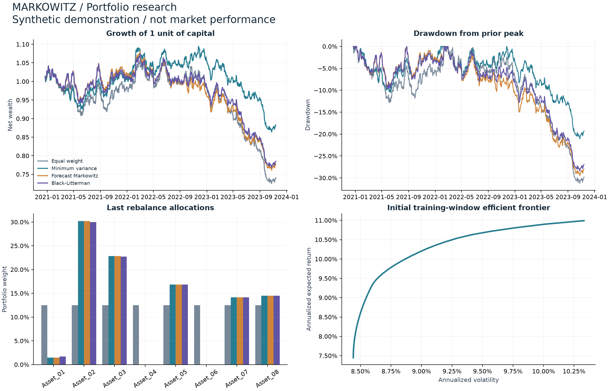

# Markowitz Portfolio Management

**A reproducible study of how return forecasts change portfolio allocation.**

This project connects stock-return forecasting to constrained mean-variance optimization, then tests the resulting portfolios out of sample. It compares direct forecast-driven allocations with a Black–Litterman update and two simple benchmarks.

The question is straightforward: **does a more elaborate return estimate produce a better portfolio after trading costs?** The code separates forecast quality from investment performance so that the answer can be checked rather than assumed.

[Research notebook](notebooks/portfolio_research.ipynb) · [Methodology](docs/methodology.md) · [Results and limitations](docs/results.md)



## What is implemented

- **Forecasts:** historical mean, multi-output ridge regression, LSTM, BiLSTM, and a CNN–BiLSTM hybrid.
- **Portfolios:** equal weight, minimum variance, maximum expected Sharpe, and Black–Litterman with forecast-derived views.
- **Constraints:** long-only, fully invested, configurable position cap, and optional top-k stock selection.
- **Evaluation:** rolling training windows, purged neural validation, one-bar execution delay, drifting holdings, and proportional transaction costs.
- **Outputs:** net returns, rebalance weights, turnover, forecast errors, performance metrics, an efficient frontier, and an HTML report.
- **Checks:** analytical optimization cases, Bayesian-update limits, malformed input, cost accounting, and a future-data perturbation test.

## Run the project

Python 3.11 or newer is required. Run these commands from the repository root:

```bash
python -m venv .venv
source .venv/bin/activate
# Windows: .venv\Scripts\activate
pip install -e '.[dev]'
markowitz --output outputs/ridge
pytest -q
```

Open `outputs/ridge/report.html` to review the experiment. The default run uses eight artificial assets and requires no API key or live data service.

For the neural models:

```bash
pip install -e '.[neural]'
markowitz --model cnn_bilstm --epochs 12 --output outputs/cnn_bilstm
python scripts/compare_models.py --neural --output outputs/comparison
```

`--model lstm` and `--model bilstm` run the recurrent baselines. Neural models train on CPU with a fixed seed. Exact floating-point results may vary across platforms and library versions.

## Use your own data

Supply daily adjusted prices with one row per observation and one column per asset:

```csv
date,ASSET_A,ASSET_B,ASSET_C
2024-01-02,100.00,80.00,120.00
2024-01-03,100.60,79.80,120.50
```

The snippet shows the format only; a run needs more observations than its training window plus the execution delay. Dates must be ascending and unique; values must be positive, finite, and complete. Missing prices are rejected rather than silently filled.

```bash
markowitz --prices data/my_adjusted_prices.csv \
  --train-window 252 --rebalance 21 --top-k 5 \
  --max-weight 0.30 --cost-bps 10 --risk-free 0.02 \
  --output outputs/custom
```

The position cap must allow full investment: `top_k × max_weight >= 1`. Omit `--top-k` to retain all assets. The equal-weight benchmark always uses the full supplied universe; optimized strategies use the selected subset.

## How to read the results

The checked-in runs use **synthetic data**, not observed stock prices. They demonstrate the full workflow and make the project runnable offline. They do not establish an investment edge or reproduce a historical SET50 study.

The report distinguishes training-sample expectations from realized test-period returns. It records every rebalance and any minimum-variance fallback when positive expected excess return is infeasible. The Black–Litterman reference allocation is equal weight; it is not described as a market-cap portfolio.

Read [the methodology](docs/methodology.md) for the equations, timing conventions, and modeling tradeoffs, and [the results note](docs/results.md) for the measured demo results and remaining research questions.

## Repository layout

```text
src/markowitz/     Data validation, forecasts, allocation, backtesting, reporting
notebooks/        Executable walkthrough
scripts/          Sample-data generation and model comparisons
tests/            Numerical and integration checks
data/             Artificial sample and provenance notes
reports/          Reproducible demonstration outputs
docs/             Methodology and experiment interpretation
```

## Author

[Piyush Kumar](https://github.com/Piyush-Spectro)

Educational portfolio research. The models and example allocations are not investment recommendations.
