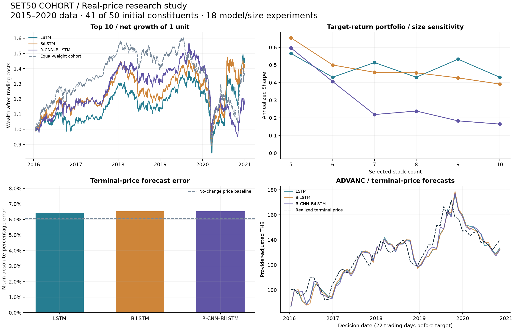

# SET50 study: measured results

## Scope

The primary study uses real Yahoo Finance adjusted prices for **41 stocks** from the January 2015 SET50 cohort. The panel contains **1,462 observations**, from **2015-01-05 to 2020-12-30**. The first 252 returns are training history; evaluation begins 2016-01-18 and ends 2020-12-30.

All **18 combinations** of LSTM, BiLSTM and R-CNN–BiLSTM with top 5, 6, 7, 8, 9 and 10 stocks were run. The primary strategy minimizes variance subject to an 8% annual expected-return target, a 35% position cap and full investment. Infeasible targets are lowered and logged; realized returns are not guaranteed to reach the requested target.

The historical list contained 50 stocks. Eight histories were unavailable and BANPU had insufficient early coverage. The resulting fixed coverage subset is not a survivorship-free reconstruction of the changing SET50 index. [Coverage and source audit](../data/set50/README.md).



## Top-10 target-return portfolios

These figures are net of 10 bps per unit bought or sold, including initial investment. The risk-free assumption is 2% annually. Arithmetic annual mean and CAGR are intentionally reported separately.

| Model | Total return | Annual mean | CAGR | Volatility | Sharpe | Max drawdown | Lowered targets |
| --- | ---: | ---: | ---: | ---: | ---: | ---: | ---: |
| LSTM | 46.94% | 9.61% | 8.36% | 17.75% | 0.430 | -39.08% | 2/58 |
| BiLSTM | 42.81% | 9.09% | 7.72% | 18.15% | 0.392 | -38.61% | 3/58 |
| R-CNN–BiLSTM | 17.26% | 4.75% | 3.38% | 16.85% | 0.165 | -39.50% | 1/58 |

The full-cohort equal-weight benchmark returned **35.46%**, with Sharpe **0.337** and maximum drawdown **-44.62%**. This is a portfolio of the included stocks, not the official SET50 total-return index.

## All portfolio sizes

Annualized Sharpe ratios for the forecast-based target-return portfolios:

| Selected stocks | LSTM | BiLSTM | R-CNN–BiLSTM |
| --- | ---: | ---: | ---: |
| 5 | 0.566 | 0.654 | 0.597 |
| 6 | 0.431 | 0.500 | 0.406 |
| 7 | 0.514 | 0.459 | 0.219 |
| 8 | 0.430 | 0.455 | 0.239 |
| 9 | 0.533 | 0.427 | 0.183 |
| 10 | 0.430 | 0.392 | 0.165 |

## Price prediction

Errors use complete forecast horizons only. Price MAE/RMSE use provider-adjusted THB levels; MAPE compares relative accuracy across stocks. The no-change baseline predicts the last observed adjusted price. The ADVANC chart is a fixed alphabetical example, not the stock chosen for the best forecast fit.

| Model | Price MAE | Price RMSE | MAPE | Direction accuracy |
| --- | ---: | ---: | ---: | ---: |
| LSTM | 2.685 | 5.224 | 6.43% | 50.36% |
| BiLSTM | 2.734 | 5.318 | 6.53% | 50.06% |
| R-CNN–BiLSTM | 2.710 | 5.250 | 6.53% | 49.51% |

No-change-price baseline MAPE: **6.07%**. Each model was scored on **2,337** asset/horizon predictions.

## Interpretation

All three neural models had higher MAPE than the no-change-price baseline in this run. The top-10 hybrid portfolio also had a lower Sharpe ratio than either recurrent baseline. These results do not support a claim that the hybrid is superior.

A low price error does not by itself establish profitable stock selection. The ranking step, covariance estimate, target feasibility, weight cap and trading costs all affect realized portfolio outcomes. Compare model results with the simple benchmark and the no-change forecast rather than assuming that the hybrid must perform best.

These are descriptive results from one historical interval and one seed, not significance tests. No model or portfolio size is designated a winner for live investment. Future work should use licensed point-in-time constituent and delisting records, multiple seeds, transaction-cost stress tests, and nested chronological tuning.

## Reproduce

```bash
pip install -e '.[dev,neural]'
python scripts/download_set50.py
python scripts/run_set50_study.py
python scripts/report_set50.py
python scripts/execute_notebook.py
pytest -q
```

Raw provider responses and cleaned price panels stay local. Source hashes, all configurations, derived forecasts, trade logs, allocations, metrics and latest model checkpoints are included. Neither supplied PDF is included.

- [Portfolio metrics for every combination](../reports/set50/portfolio_metrics.csv)
- [Price-prediction metrics](../reports/set50/price_metrics.csv)
- [Run metadata](../reports/set50/metadata.json)
- [R-CNN–BiLSTM price forecasts](../reports/set50/rcnn_bilstm/price_forecasts.csv)
- [Executed notebook](../notebooks/portfolio_research.ipynb)
- [Methodology and assumptions](methodology.md)
